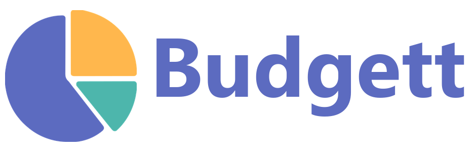

<p align="center">
  
</p>

A self-hosted budget management app powered by Plaid.

Budgett pulls in your real transactions, helps you categorize them (automatically, most of the time), and tells you where you actually stand against a budget — without handing your financial data to a SaaS company.

**[Try the live demo →](https://derekantrican.com/Budgett)** It runs entirely in your browser with made-up data (no server, no Plaid), and anything you change is saved only in your browser.

## Features

- **Plaid-first transaction syncing** — incremental, cursor-based sync via Plaid's `transactions/sync` webhook
- **Manual transaction entry** for cash or accounts you don't want to link
- **Transaction splits** — break one transaction across multiple categories, with spreadsheet-style split amounts (e.g. `=CEILING(amount/2, 0.01)`) that stay editable
- **Category budgets** — budgeted amounts can be plain numbers or `=`-prefixed formulas (e.g. `=-150*sundays`, `=income_gross*0.1`), with variables for weekdays/days/weeks and your monthly income so a budget can scale with the month
- **Category management** — custom colors, drag-to-reorder, hide instead of delete, and merge-or-disassociate flows when deleting a category that still has transactions
- **Auto-categorization rules** — regex pattern matching with optional amount conditions, merchant renaming, and split rules; when you rename or categorize the same (fuzzy-matched) merchant the same way several times, the app creates the rule for you (can be turned off)
- **Customizable Summary dashboard** — drag-and-resize tiles for category spending (pie charts, a month-by-month year table), budget status, account balances, income, and your Planning views
- **Income tracking** — salary, hourly, per-unit (commission), or fixed-per-paycheck income sources with deductions, pay schedules, and per-month paycheck counts (e.g. 3-paycheck months)
- **Planning views** — loan/mortgage amortization (with PMI, property tax, extra-payment scenarios, and a payment ledger), retirement growth projections, and emergency-fund sizing based on your essential categories
- **Extensions** — add your own pages, dashboard tiles, and server-side sync hooks as plain JavaScript files, without forking the app (see [EXTENSIONS.md](EXTENSIONS.md) and [`examples/extensions/`](examples/extensions/))
- **Transaction templates** — one-click presets for recurring transactions
- **Transfer detection** — fuzzy-matches a transaction on one account to its counterpart on another, with a dedicated Money Movement view visualizing transfers between your own accounts
- **Incomplete Transactions view** — surfaces anything missing a category (including a single uncategorized split on an otherwise-categorized transaction) so nothing falls through the cracks
- **Generalized notifications** — outgoing webhooks (e.g. Discord) with configurable message templates and variable placeholders, fired on events like rule matches, new transactions, and Plaid item errors
- **Admin tools** — activity log, webhook inspector (incoming/outgoing payloads), incomplete transactions, money movement
- **Plaid Link management** — connect/reconnect institutions, handle account-selection changes on reconnect, and choose what happens to a removed institution's transaction history
- **Configurable date/number formats** and a Plaid sandbox/production environment switch
- **Dark mode** UI throughout
- **Bulk transaction importer** (`server/scripts/import-transactions.js`) for migrating historical data from `.xlsx`/`.csv`
- **Lightweight** — SQLite via `better-sqlite3`, no external database server
- **Docker support** for deployment

> [!NOTE]
> Budgett currently has **no authentication** — every API route, including the admin endpoints and the Plaid webhook, is open. It's built for a single user running it on a trusted network (e.g. a home server behind a Cloudflare Tunnel or VPN), not for exposing directly to the public internet. Multi-user auth is on the [roadmap](#roadmap) but not implemented yet. Adding your own auth (e.g. a login-gated reverse proxy) in the meantime is highly recommended — but if you do, **exempt `/api/webhook` from it**, since Plaid calls that endpoint directly and can't participate in a login flow.

## Tech Stack

- **Backend:** Node.js + Express
- **Frontend:** React 19 (CRA) + React Bootstrap, Recharts for charts
- **Database:** SQLite (via `better-sqlite3`)
- **Plaid SDK:** `plaid` (Node)

## Getting Started

### Prerequisites

- Node.js (LTS recommended)
- A [Plaid developer account](https://dashboard.plaid.com)

### Setup

1. Clone the repository
2. Copy `.env.template` to `.env` and fill in your Plaid credentials
   ```bash
   cp .env.template .env
   ```
3. Install dependencies (root + server + client):
   ```bash
   npm run install:all
   ```
4. Initialize the database:
   ```bash
   npm run db:init
   ```
5. Start the app in development mode:
   ```bash
   npm run dev
   ```

This runs the CRA dev server (`http://localhost:3000`, hot-reload) alongside the Express API (`http://localhost:5000`), with `/api` proxied from the client to the server.

### Production

```bash
cd client && npm run build && cd ..
NODE_ENV=production node server/index.js
```

This serves the built React app and the `/api/*` routes from a single Express process on one port (`5000`) — no separate client process to manage. Useful for deployment on a home server or Raspberry Pi behind a Cloudflare Tunnel: set `WEBHOOK_URL` in `.env` to your tunnel URL so Plaid can reach you.

A `Dockerfile` and `docker-compose.yml` are also provided if you'd rather run it in a container. See [docs/running.md](docs/running.md) for more detail on the development and production setups.

## Project Structure

```
Budgett/
├── client/              # React frontend (CRA)
│   ├── demo/            # 404.html redirect for the GitHub Pages demo
│   └── src/
│       ├── components/  # Shared components (incl. dashboard tiles & planning views)
│       ├── demo/        # In-browser mock API + seed data for the demo build
│       ├── helpers/     # Budget formulas, income, loan/retirement/emergency-fund math
│       ├── pages/       # Route pages
│       │   └── admin/   # Admin subpages
│       ├── services/    # API helper
│       └── utils/       # Formatting & extension host
├── server/              # Express backend
│   ├── db/              # Database init & queries
│   ├── helpers/         # Notifications, rules, auto-rules, formulas, logging
│   ├── services/        # Extension loader, external integrations (e.g. SimpleFIN)
│   ├── middleware/      # Error handling
│   ├── routes/          # API routes
│   ├── scripts/         # One-off/maintenance scripts (transaction import, webhook migration)
│   └── webhookHandlers/ # Plaid webhook processing
├── database/            # SQLite schema
├── docs/                # Additional docs
├── examples/extensions/ # Example extensions (see EXTENSIONS.md)
├── .github/workflows/   # GitHub Pages demo deployment
├── Dockerfile / docker-compose.yml
├── .env.template        # Environment config template
└── package.json         # Root scripts
```

## Roadmap

Things that are planned but not built yet:

- **SimpleFIN support** as an alternative/complement to Plaid for institutions that support it (a bridge client already exists at `server/services/simplefin.js`, not yet wired into syncing)
- **Universal variables** (e.g. `$CAT(Groceries)`) usable across budget formulas and dashboard tiles
- **Per-category time-scoping** — categories that can expire or roll over instead of persisting forever
- **Authentication & multi-user roles** (admin, user, read-only) for deployments beyond a single trusted user

## License

Budgett is source-available under the [Creative Commons Attribution-NoDerivatives 4.0 International License](LICENSE) (CC BY-ND 4.0). You're free to use, self-host, and share it unchanged, as long as you credit the original project. Distributing modified versions is not permitted.
